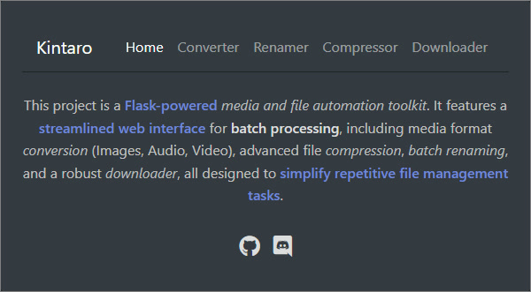
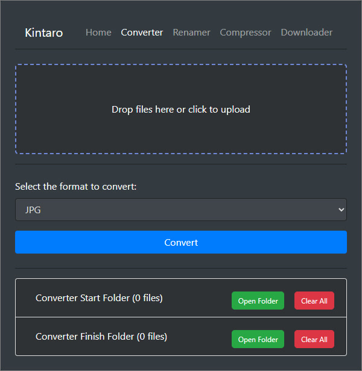
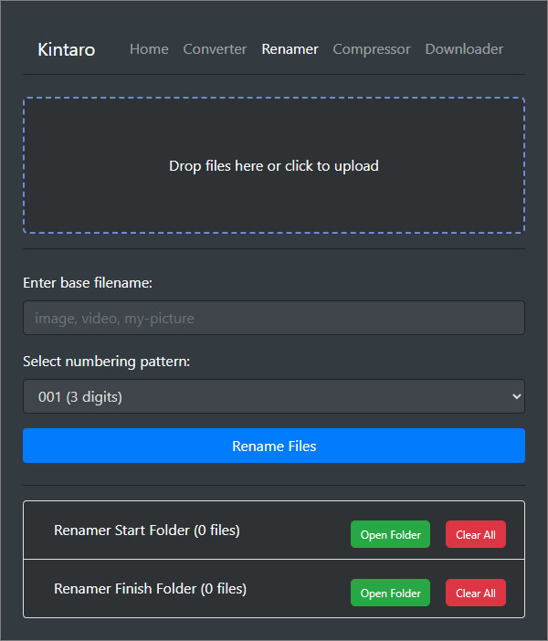
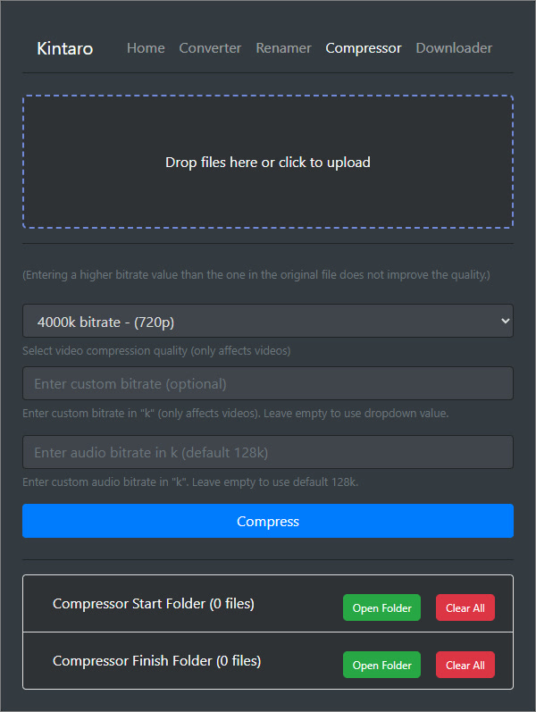
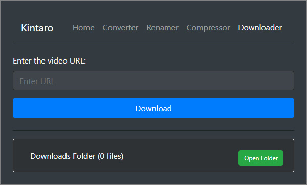

<a href="README.md">
  
</a>
<a href="README-TR.md">
  
</a>

  <br />
  <br />

<div align="center">
  
  <br />
  <br />

  <p>
     Medya dosyalarını kendi bilgisayarınızda dönüştürün, sıkıştırın, adlandırın ve indirin.
  </p>


  <p>
    <a href="#about">Hakkında</a> •
    <a href="#features">Özellikler</a> •
    <a href="#tech">Teknolojiler</a> •
    <a href="#setup">Kurulum</a> •
    <a href="#gallery">Galeri</a> •
    <a href="#license">Lisans</a>
  </p>

  <br />
  <br />
</div>

## <a id="about"></a> 📋 Hakkında

**Kintaro Tools**, günlük medya işlerini tek bir arayüzde toplayan bir web uygulamasıdır. Dosyaları biçimler arasında dönüştürür, video ve sesleri sıkıştırır, dosyaları toplu olarak yeniden adlandırır ve internetten video indirir.

Her şey kendi bilgisayarınızda çalışır, yani dosyalarınız hiçbir çevrimiçi hizmete yüklenmez. Her aracın kendi giriş ve çıkış klasörleri vardır ve dosyaları sayfaya sürükleyerek bu klasörlere ekleyebilirsiniz.

## <a id="features"></a> ✨ Özellikler

- **Dosya dönüştürücü**: Görselleri `JPG`, `PNG` ve `WEBP`, videoları `MP4`, `AVI`, `MOV` ve `WEBM`, sesleri ise `MP3`, `WAV`, `AAC`, `FLAC` ve `OGG` biçimleri arasında dönüştürün.
- **Dosya sıkıştırıcı**: Videoların boyutunu hazır ya da özel bir bit hızıyla küçültün, ses bit hızını kendiniz belirleyin.
- **Toplu yeniden adlandırıcı**: Tüm dosyaları bir önek ve `picture_001.jpg` gibi 3 ila 6 basamaklı sıfır dolgulu bir numarayla yeniden adlandırın. Orijinal uzantılar korunur.
- **Video indirici**: YouTube, Instagram, TikTok ve yt-dlp'nin desteklediği diğer sitelerden video indirin. Videolar mevcut en iyi kalitede MP4 olarak, adı zaman damgası olacak şekilde kaydedilir.
- **Sürükle ve bırak ile yükleme**: Dosyaları sayfaya sürükleyerek ya da seçerek bir araca ekleyin.
- **Klasör kısayolları**: Bir aracın çalışma klasörlerini tek tıkla açın ya da temizleyin.

## <a id="tech"></a> 🛠️ Teknolojiler

`Python` · `Flask` · `Pillow` · `MoviePy` · `FFmpeg` · `yt-dlp` · `Bootstrap` · `jQuery` · `JavaScript` · `Font Awesome`

## <a id="setup"></a> 🚀 Kurulum

### Gereksinimler

- **Python 3**

### Adım Adım Kurulum

1. **Depoyu klonlayın**

   ```bash
   git clone https://github.com/xkintaro/kintaro-py-tools.git
   cd kintaro-py-tools
   ```

2. **Bağımlılıkları yükleyin**

   ```bash
   pip install -r requirements.txt
   ```

   Windows'ta bunun yerine `install_requirements.bat` dosyasını çalıştırabilirsiniz.

3. **Uygulamayı başlatın**

   ```bash
   python app.py
   ```

   Windows'ta bunun yerine `run.bat` dosyasını çalıştırabilirsiniz.

Uygulama, tarayıcınızda [http://127.0.0.1:5000](http://127.0.0.1:5000) adresini otomatik olarak açar. 5000 portu kullanılıyorsa sıradaki boş port seçilir.

### Kullanım

Uygulama klasör tabanlı bir iş akışı kullanır:

1. Dosyalarınızı aracın `Start` klasörüne ekleyin.
2. Ayarlarınızı seçin ve işlemi başlatın.
3. İşlenen dosyalar aracın `Finish` klasöründe görünür. Kaynak dosyalar başarıyla işlendikten sonra `Start` klasöründen silinir.

Her aracın kendi klasör çifti vardır:

| Araç | Giriş Klasörü | Çıkış Klasörü |
|---|---|---|
| Dönüştürücü | `converterStart/` | `converterFinish/` |
| Sıkıştırıcı | `compressorStart/` | `compressorFinish/` |
| Yeniden adlandırıcı | `renamerStart/` | `renamerFinish/` |
| İndirici | — | `downloads/` |

## <a id="gallery"></a> 🖼️ Galeri











## <a id="license"></a> 📄 Lisans

Bu proje MIT Lisansı altında lisanslanmıştır. Detaylar için [LICENSE](LICENSE) dosyasına bakabilirsiniz.

#

<p align="center">
  <sub>❤️ Developed by "Mustafa TAŞAL" (kintaro)</sub>
</p>
