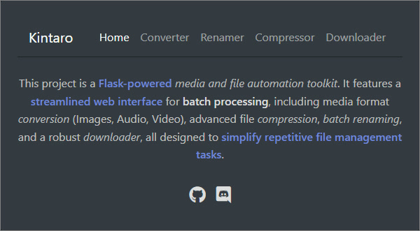
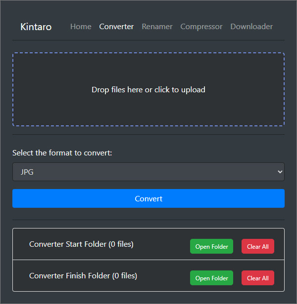
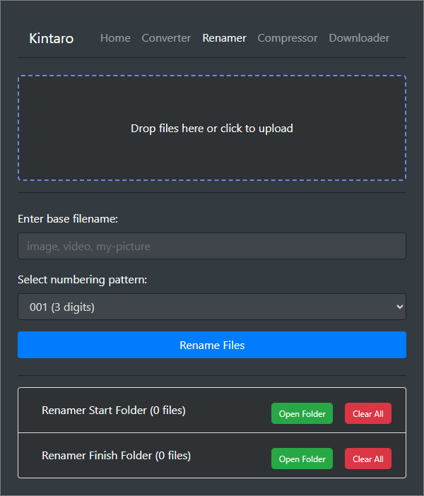
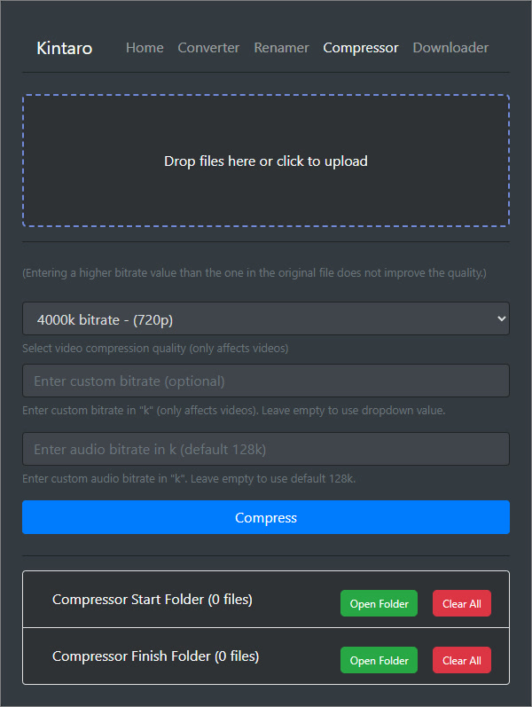
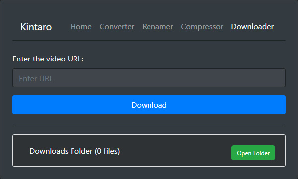

<a href="README.md">
  
</a>
<a href="README-TR.md">
  
</a>

  <br />
  <br />

<div align="center">
  
  <br />
  <br />

  <p>
     Convert, compress, rename and download media files on your own computer.
  </p>


  <p>
    <a href="#about">About</a> •
    <a href="#features">Features</a> •
    <a href="#tech">Tech</a> •
    <a href="#setup">Setup</a> •
    <a href="#gallery">Gallery</a> •
    <a href="#license">License</a>
  </p>

  <br />
  <br />
</div>

## <a id="about"></a> 📋 About

**Kintaro Tools** is a web application that brings everyday media tasks together in one interface. It converts files between formats, compresses videos and audio, renames files in bulk and downloads videos from the internet.

Everything runs on your own computer, so your files are never uploaded to an online service. Each tool works with its own input and output folders, and you can add files to them by dragging them onto the page.

## <a id="features"></a> ✨ Features

- **File converter**: Convert images between `JPG`, `PNG` and `WEBP`, videos between `MP4`, `AVI`, `MOV` and `WEBM`, and audio between `MP3`, `WAV`, `AAC`, `FLAC` and `OGG`.
- **File compressor**: Reduce the size of videos with a preset or custom bitrate, and set the audio bitrate yourself.
- **Batch renamer**: Rename all files with a prefix and a zero-padded number of 3 to 6 digits, such as `picture_001.jpg`. The original extensions are kept.
- **Video downloader**: Download videos from YouTube, Instagram, TikTok and the other sites supported by yt-dlp. Videos are saved in the best available quality as MP4, with a timestamp as their name.
- **Drag and drop upload**: Add files to a tool by dragging them onto the page or by selecting them.
- **Folder shortcuts**: Open the working folders of a tool or clear them with a single click.

## <a id="tech"></a> 🛠️ Tech

`Python` · `Flask` · `Pillow` · `MoviePy` · `FFmpeg` · `yt-dlp` · `Bootstrap` · `jQuery` · `JavaScript` · `Font Awesome`

## <a id="setup"></a> 🚀 Setup

### Requirements

- **Python 3**

### Step-by-Step Installation

1. **Clone the repository**

   ```bash
   git clone https://github.com/xkintaro/kintaro-py-tools.git
   cd kintaro-py-tools
   ```

2. **Install dependencies**

   ```bash
   pip install -r requirements.txt
   ```

   On Windows you can run `install_requirements.bat` instead.

3. **Start the application**

   ```bash
   python app.py
   ```

   On Windows you can run `run.bat` instead.

The application opens [http://127.0.0.1:5000](http://127.0.0.1:5000) in your browser automatically. If port 5000 is in use, the next free port is chosen.

### Usage

The application uses a folder based workflow:

1. Add your files to the `Start` folder of the tool.
2. Choose your settings and start the process.
3. The processed files appear in the `Finish` folder of the tool. The source files are removed from the `Start` folder after they are processed successfully.

Each tool has its own pair of folders:

| Tool | Input Folder | Output Folder |
|---|---|---|
| Converter | `converterStart/` | `converterFinish/` |
| Compressor | `compressorStart/` | `compressorFinish/` |
| Renamer | `renamerStart/` | `renamerFinish/` |
| Downloader | — | `downloads/` |

## <a id="gallery"></a> 🖼️ Gallery











## <a id="license"></a> 📄 License

This project is licensed under the MIT License. See the [LICENSE](LICENSE) file for details.

#

<p align="center">
  <sub>❤️ Developed by "Mustafa TAŞAL" (kintaro)</sub>
</p>
